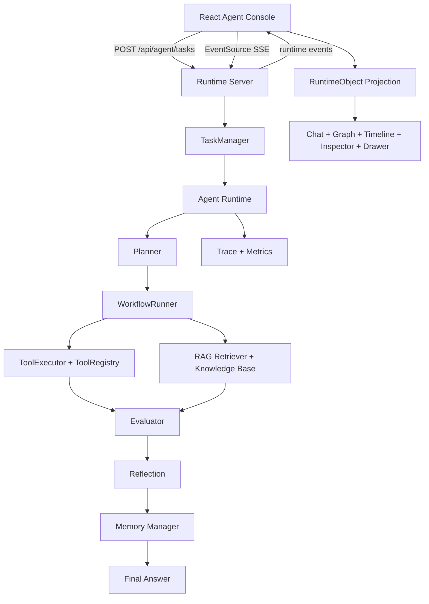

# Agent Studio ｜ AI Agent Runtime Studio

[](https://github.com/novedu/agent-studio/actions/workflows/ci.yml)


**一句话**：把 AI Agent 的规划、工具调用、检索、反思与评测过程，变成可观察、可调试的事件流。

TypeScript · React · Node.js · Zustand · SSE · npm workspaces ｜ LLM 接入 OpenAI 兼容模型（未配置 Key 时 Mock 回退）｜ RAG 为关键词检索，详见 [Implementation Notes](#implementation-notes)


*本地 demo 的真实录屏：从 idle 一次 `Run full demo` 跑到 `success`，包含事件速率曲线、依赖图和 Timeline 切换。*

> Agent 执行是黑盒：调了哪个工具、检索到什么、为什么失败，都看不到。
> 这个项目用 Runtime Event 记录全过程，并投影到 Chat / Graph / Timeline / Inspector 四个同步视图；
> 一次演示任务会走完 Planning → Tool Call → Knowledge Retrieval → Evaluation → Reflection → Memory Update → Final Answer。

## Project Introduction

Agent Studio turns a running AI agent into a runtime console: four synchronized views (Chat / Graph / Timeline / Inspector) projected from a single runtime state model. It is not a ChatGPT clone, not a dashboard template, and not a fake SaaS shell.

The main demo starts with:

```text
分析华东区域销售下降原因，并生成报告
```

The runtime then moves through:

```text
Planning -> Tool Call -> Knowledge Retrieval -> Evaluation -> Reflection -> Memory Update -> Final Answer
```

The `/agent` page is the product center. Chat is the primary workspace. Graph explains runtime dependency. Timeline debugs event flow. Inspector and Drawer explain the selected RuntimeObject.

## Features

- **Agent Runtime lifecycle**: Planner, WorkflowRunner, ToolExecutor, RAG, Evaluation, Reflection, Memory, and Final Answer.
- **Real Runtime Server**: task creation, task query, cancel, task retry, step-level retry with corrected args, and SSE event streaming.
- **RuntimeObject model**: one projected object model shared by Chat, Graph, Timeline, Inspector, Drawer, Evidence, Memory, and Evaluation.
- **Execution Graph**: compact dependency graph for Planner, Workflow, Tool, Knowledge, Evaluation, Reflection, Memory, and Answer.
- **Debug Timeline**: runtime events with component, status, duration, retry, token, metadata, input, and output.
- **Professional Inspector**: object-driven panels for execution, input, output, reasoning, events, evidence, memory, evaluation, and logs.
- **Demo path**: one-click happy-path task, plus a real tool failure you can fix and retry at the failed step.
- **Run-scoped views**: Run Detail tabs for Overview / Evidence / Memory / Quality / Events; the sidebar only has Agent and Runs.
- **Persistent run history**: tasks and events survive a restart; Runs opens a read-only run detail with steps, attempts and the final answer.
- **Per-run model identity**: each task records the provider/model that served it; the header shows `Mock · 模板` or the real model name.

## Architecture



## Runtime Flow

```text
User Goal
  -> createAgentTask(input)
  -> Runtime Server creates task
  -> Agent Runtime emits events
  -> SSE streams AgentServerEvent
  -> Zustand updates session state
  -> RuntimeObject projection
  -> Chat / Graph / Timeline / Inspector / Drawer synchronize
```

Supported events include:

```text
task_created
plan_start
plan_update
tool_start
tool_success
tool_error
task_retry
rag_retrieve
memory_update
reflection
evaluation_start
evaluation_complete
state_update
final_answer
task_complete
```

## Demo Screenshots

Screenshots are captured from the same local demo task (the recording above is the moving version):

```text
分析华东区域销售下降原因，并生成报告
```

The seven frames below follow one runtime session from idle to evaluation. They are intentionally shown as full-width frames so the runtime behavior remains legible on the GitHub project page.

### 1. Idle Runtime Console

Ready state before the task starts: quick demo entry, runtime path, and the initial Inspector context.


### 2. Running Agent Task

The sales decline task is active and the console follows the current `RuntimeObject`.


### 3. Tool Call

`ToolExecutor` calls sales-data and metric tools while Chat, Graph, Timeline, and Inspector update together.


### 4. Knowledge Retrieval

RAG retrieves evidence for the East China sales decline causes and exposes source chunks.


### 5. Debug Timeline

The Timeline shows runtime events, duration, component, status, retry, token, and task context.


### 6. Runtime Inspector

The selected Final Answer object exposes output, evidence, dependencies, and the event history.


### 7. Evaluation

Evaluation Center shows score, criteria, feedback, and quality review for the completed sales task.


## Tech Stack

| Layer | Technology |
| --- | --- |
| Frontend | React, TypeScript, Vite, React Router |
| State | Zustand |
| UI | Tailwind CSS, Framer Motion, local design tokens |
| Server | Node.js HTTP server, TypeScript |
| Streaming | Server-Sent Events |
| Runtime | Planner, WorkflowRunner, ToolExecutor, RAG, Memory, Reflection, Evaluation |
| Shared Contracts | TypeScript shared-types package |

## Documentation

The project documentation is organized by responsibility:

- [Product](docs/PRODUCT.md): positioning, users, information architecture, and roadmap context.
- [Design](docs/DESIGN.md): visual principles and Runtime Workspace direction.
- [UX](docs/UX.md): navigation, interaction, and runtime state transitions.
- [Design System](docs/DESIGN_SYSTEM.md): shared tokens and component rules.
- [Architecture](docs/ARCHITECTURE.md): frontend, server, runtime, and streaming boundaries.
- [Demo Scripts](docs/DEMO_SCRIPT.md): 3-minute, 10-minute, and 30-minute walkthroughs.
- [Contributing](docs/CONTRIBUTING.md): development flow and verification commands.
- [Performance](docs/PERFORMANCE.md): telemetry cost, bundle split, and how to reproduce.
- [Changelog](docs/CHANGELOG.md): implementation history.

## Folder Structure

```text
apps/
├── agent-console/
│   └── src/
│       ├── components/
│       ├── features/agent-console/
│       ├── hooks/
│       ├── layout/
│       ├── pages/
│       ├── router/
│       ├── services/
│       ├── store/
│       ├── theme/
│       └── types/
└── runtime-server/
    └── src/
        ├── runtime/
        ├── sse/
        └── task/

packages/
├── agent-runtime/
│   └── src/
│       ├── agent/
│       ├── evaluation/
│       ├── llm/
│       ├── memory/
│       ├── observability/
│       ├── planner/
│       ├── rag/
│       ├── tool/
│       └── workflow/
├── shared-types/
└── shared-utils/

docs/
├── PRODUCT.md
├── DESIGN.md
├── UX.md
├── DESIGN_SYSTEM.md
├── ARCHITECTURE.md
├── ROADMAP.md
├── DEMO_SCRIPT.md
├── screenshots/
└── media/
```

## 接入真实模型（DeepSeek / OpenAI）

默认是无 key 的 Mock 模式（输入框下方会显示 `MOCK` 徽标，回答由本地模板生成）。接真实模型三步：

```bash
cp .env.example .env      # .env 已被 git-ignore
# 编辑 .env，填入 DEEPSEEK_API_KEY=...
npm run server
```

服务端按顺序解析：

| 优先级 | 变量 | 默认值 |
| --- | --- | --- |
| 1 | `DEEPSEEK_API_KEY` | baseURL `https://api.deepseek.com/v1`，model `deepseek-chat` |
| 2 | `OPENAI_API_KEY` | baseURL `https://api.openai.com/v1`，model `gpt-4.1-mini` |
| 3 | 都没有 | Mock 模式 |

`GET /health` 返回当前实际 provider、model 和可读 label（例如 `Mock · 模板` 或 `DeepSeek · deepseek-chat`）。控制台的顶部 Model 选择器和 `MOCK` 徽标都依据它显示，不再使用占位文案。

### 密钥安全

- `.env`、`.env.*` 都在 `.gitignore` 里，仓库里只有空占位的 `.env.example`。
- `npm test` 的第一步是 `node scripts/check-secrets.mjs`：扫描所有 git 跟踪的文件，命中 `sk-` 形状或非空的 `*_API_KEY=` 直接失败退出。
- 单独检查：`npm run check:secrets`。
- 万一提交过：**先去平台吊销这个 key**，再清理历史（`git filter-repo`）。只删文件不够，历史里还在。

## Quick Start

> 未配置 `OPENAI_API_KEY` 时服务端运行在 **Mock 模式**：界面底部会显示 `Mock` 标记，回答来自本地模板而不是模型调用。想看完整脚本化链路，请提问「分析华东区域销售下降原因，并生成报告」。

Install dependencies:

```bash
npm install
```

Optional: copy the frontend environment template if you want to customize local settings.

```bash
cp apps/agent-console/.env.example apps/agent-console/.env
```

Start the Runtime Server:

```bash
npm run server
```

Start the React Console in another terminal:

```bash
npm --prefix apps/agent-console run dev
```

Or start both processes with one command:

```bash
npm run dev:all
```

Open:

```text
http://127.0.0.1:5173/agent
```

The Runtime Server health endpoint is:

```text
http://127.0.0.1:3001/health
```

Frontend environment:

```text
apps/agent-console/.env.example
VITE_AGENT_SERVER_URL=http://127.0.0.1:3001
```

## Demo

Primary demo task:

```text
分析华东区域销售下降原因，并生成报告
```

Expected demo sequence:

```text
1. Chat receives the business goal.
2. Planner creates executable steps.
3. ToolExecutor queries sales data and calculates metrics.
4. RAG retrieves relevant knowledge chunks.
5. Evaluation scores completeness, accuracy, groundedness, and task completion.
6. Reflection records whether the run passed the check.
7. Memory stores working / episodic / semantic context.
8. Final Answer streams into Chat as Markdown.
9. Graph, Timeline, Inspector, Drawer, Evidence, Memory, and Evaluation stay synchronized.
```

Demo scripts:

- [3-minute overview](docs/DEMO_SCRIPT.md#3-minute-demo)
- [10-minute technical walkthrough](docs/DEMO_SCRIPT.md#10-minute-demo)
- [30-minute deep dive](docs/DEMO_SCRIPT.md#30-minute-demo)

## Verification

```bash
npm run lint
npm run test
npm run build
```

Note: in restricted sandbox environments, `tsx` and Vite may fail with local IPC or port-listening errors such as `listen EPERM ... tsx-501/*.pipe`. Run the same commands in a normal local terminal for final verification.

The test suite covers RuntimeObject projection, SSE event projection, Knowledge and Memory derived views, Timeline modeling, Inspector rendering, and the Runtime Server health endpoint.

## Performance

- **Frame-gated telemetry.** Event ingestion is incremental; the chart paints at most once per animation frame and pauses when the tab is hidden.
- **Bounded memory.** A capped 60-bucket ring buffer keeps per-frame cost flat as the session grows, instead of rescanning the full event array.
- **Code-split chart.** ECharts ships in its own lazy chunk, so the console's first-screen chunk stays at 200 kB (56 kB gzip) instead of 699 kB (226 kB gzip).

Numbers, method and limitations: [docs/PERFORMANCE.md](docs/PERFORMANCE.md). Reproduce with `npx tsx scripts/bench-event-rate.ts`.

## Implementation Notes

本节说明各能力的实现方式与当前范围。

### 1 · Real LLM Provider

LLM 层是可替换的抽象（`packages/agent-runtime/src/llm/provider.ts`）：

```ts
export interface LLMProvider {
  name: string
  chat(messages: ChatMessage[], tools?: ToolDefinition[]): Promise<LLMResponse>
}
```

`OpenAIProvider`（`llm/openai-provider.ts`，143 行）实现**真实模型调用**：

- 真实 `fetch` 请求 `${baseURL}/chat/completions`，携带 `Authorization: Bearer ${apiKey}`
- 默认 `baseURL = https://api.openai.com/v1`，`model = gpt-4.1-mini`
- 解析 `choices[0].message` 与 `tool_calls`（含 `function.name` / `function.arguments`）
- 对 HTTP 错误、空响应、tool call 字段缺失、参数解析失败做**错误归一化**

由于走的是 OpenAI **兼容协议**，修改 `baseURL` 即可对接 DeepSeek / Qwen 等网关。

启用方式：

```bash
OPENAI_API_KEY=sk-xxx
OPENAI_BASE_URL=https://api.openai.com/v1   # 可替换为任意兼容网关
OPENAI_MODEL=gpt-4.1-mini
```

### 2 · Mock Provider

`MockLLMProvider`（`llm/mock-llm-provider.ts`，99 行）用于**离线演示与本地开发**：

- 构造时注入一组预设响应队列，`chat()` 按 `index` 顺序返回
- 默认 `delayMs = 200`，模拟真实流式节奏
- 队列耗尽返回 `{ content: 'No more responses.', done: true }`
- 选择逻辑（`agent/main.ts`、`apps/runtime-server/src/runtime/agent-runtime-adapter.ts`）：

```ts
const realLLMProvider = process.env.OPENAI_API_KEY
  ? new OpenAIProvider({ apiKey, baseURL, model })
  : undefined
const llmProvider = realLLMProvider ?? mockLLMProvider
```

即：**无 API Key 时整条 Agent 链路依然可以跑通**，便于演示、CI 与本地开发。

### 3 · RAG 当前实现

**当前是关键词检索，不是向量检索。**

`Retriever.retrieve(query, topK = 3)`（`rag/retriever.ts`）的实际逻辑：

1. `tokenize()`：小写化 → 按中英文标点切分 → 中文额外做**二字滑窗（bigram）**切分
2. 打分：`score = matchedKeywords.length`（**命中关键词计数**）
3. 过滤 `score > 0` → 按 score 降序 → 取 `topK`

**本项目内没有 Embedding 模型、没有向量数据库、没有余弦相似度。**
知识库内容为 `createDefaultKnowledgeBase()` 注入的**内置示例文档**（`KnowledgeBase` 是内存中的文档数组）。

项目 Settings 页面原文：

> *"Document ingestion and vector index management are future work."*

向量检索与文档上传管线是明确的**下一步计划**，不是正在实现中的能力。

### 4 · 多轮对话

会话 id 由客户端持有并随每个任务发送（`conversationId`），服务端按它缓存一份 runtime bundle——planner hooks、memory、conversation history 都在里面。

- 追问会落到同一个 `ConversationManager`，上一轮的用户消息与助手回答会重新进入 prompt。
- 缓存上限 20 个会话，超出后按最早写入淘汰。
- prompt 只回放最近 24 条消息（system prompt 始终保留），避免长会话把 token 撑爆。
- 没带 id 的请求会自动新建会话，行为与之前一致。

### 5 · 步骤级重试与 Attempt

失败不是终点，而是一个可操作的状态。

- 任务快照保存 `plan` 与 `steps[]`，每个 step 下记录多次 `attempts[]`：`attemptNo` / `status` / `args` / `error` / 耗时。
- `POST /api/agent/tasks/:taskId/steps/:stepId/retry` 接收修正后的 `args`，只重跑失败的那一步，然后继续执行后续计划。
- 恢复时复用原来的 `conversationId`：之前的用户消息、工具调用和失败结果仍在上下文里，后面的 LLM 步骤不会丢失前文。
- 工具事件带 `stepId` / `attemptNo`，前端能把两次尝试区分开；失败面板可直接编辑参数并重试。
- 取消同样有明确语义：只有服务端返回 2xx 才提示“已取消”；已完成任务返回 409，控制台刷新真实状态而不是假装取消成功。
- 控制台默认按真实事件到达时间渲染。旧版的演示配速改为显式 opt-in：只有设置 `VITE_AGENT_DEMO_PACING=true` 才会逐条延迟播放。

### 6 · Run History And Per-run Model

- 任务快照写入 `AGENT_DATA_DIR`（默认 `.data/`）：`tasks.json` 保存任务、计划、步骤、attempts、trace；`events/<taskId>.jsonl` 保存完整事件流。`.data/` 已加入 `.gitignore`。
- 任务创建时记录本次运行实际使用的 `provider` 与 `model`；`/health` 返回同样的身份信息，顶部 Model 显示 `Mock · 模板` 或 `DeepSeek · deepseek-chat`，不再显示 `Runtime configured` 占位。
- `GET /api/agent/tasks/:taskId/history` 返回任务快照 + 完整事件；Runs 的任务行进入 `/runs/:taskId` 只读详情页（目标、最终答案、步骤与 attempts、事件流、provider/model）。
- 这是本地 JSON 快照，不是数据库：没有分页、搜索、清理策略，也没有把会话记忆持久化。服务重启后历史可查，但**步骤级重试**仍依赖内存里的原会话；重启后只能整任务重跑。

### 7 · Runtime 架构

monorepo 结构：`apps/`（agent-console、runtime-server）+ `packages/`（agent-runtime、shared-types、shared-utils）。

`agent-runtime` 的实际模块与导出：

| 模块 | 导出 |
|---|---|
| `agent/` | Agent、ConversationManager、EventEmitter |
| `planner/` | Planner、PlanValidator |
| `workflow/` | WorkflowRunner、AgentState |
| `tool/` | ToolRegistry、ToolExecutor（`ToolTimeoutError` / `ToolArgumentError` / `ToolNotFoundError`） |
| `rag/` | Retriever、KnowledgeBase、ContextBuilder |
| `memory/` | MemoryManager / MemoryUpdater / MemoryRetriever；Working / Episodic / Semantic 三层记忆 |
| `observability/` | TraceManager、Span、AgentMetrics |
| `evaluation/` | RuleBasedEvaluator |

`runtime-server` 负责任务生命周期（`task-manager` / `task-store` / `task-repository`）
与 SSE 事件流（`sse/event-stream.ts`），共 **20 类**运行时事件。

---

## What Is Real Today

Implemented:

- TypeScript Agent Runtime
- Planner and PlanValidator
- WorkflowRunner
- ToolRegistry and ToolExecutor
- RAG retrieval over a local knowledge base
- Working / Episodic / Semantic memory model
- Reflection
- Evaluation
- Observability primitives
- Runtime Server with task lifecycle
- SSE event streaming
- Task cancel and retry
- Step-level retry with corrected tool args and per-step attempts
- Live `state_update` events and step-based progress
- Cancel confirmation that only reports success after a 2xx response
- Persistent task/event history (local JSON/JSONL) and a read-only run detail page
- Per-run provider/model recorded on the task
- React Runtime Studio
- RuntimeObject projection for Graph / Timeline / Inspector / Drawer
- Navigation converged to **Agent** and **Runs** (plus About & limits in the sidebar footer); run-scoped Evidence / Memory / Quality live in the Run Detail tabs
- Legacy `/knowledge`, `/memory`, `/evaluation` deep links remain but show a deprecation notice; `/workflow` redirects to `/agent`
- Legacy Knowledge/Memory/Evaluation pages and the Workflow page remain in the codebase but are no longer in the primary navigation

Not implemented intentionally:

- persistent vector database
- document upload pipeline
- persistent memory database
- historical evaluation datasets
- editable workflow deployment
- RBAC / SSO / audit logs
- secret management
- billing or team administration

These are roadmap items, not fake UI claims.

## What This Project Demonstrates

This project demonstrates:

- **Frontend ability**: React architecture, TypeScript, Zustand, SSE, design system, runtime workspace, graph, timeline, inspector, drawer, and interaction design.
- **Agent ability**: Planner, workflow execution, tool runtime, RAG, memory, reflection, evaluation, trace, and runtime events.
- **Backend ability**: task lifecycle, EventSource stream, Runtime Adapter, TaskManager, cancel/retry, and shared API contracts.
- **Product judgment**: runtime-first IA, honest boundaries, demo flow, and documentation that can be walked through out loud.

This is a personal project, built to work Agent Runtime engineering through end to end in the open; scope boundaries are listed in [What Is Real Today](#what-is-real-today).
