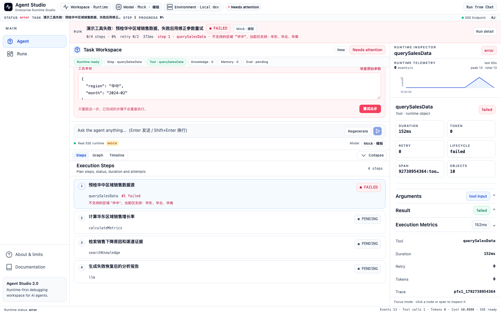
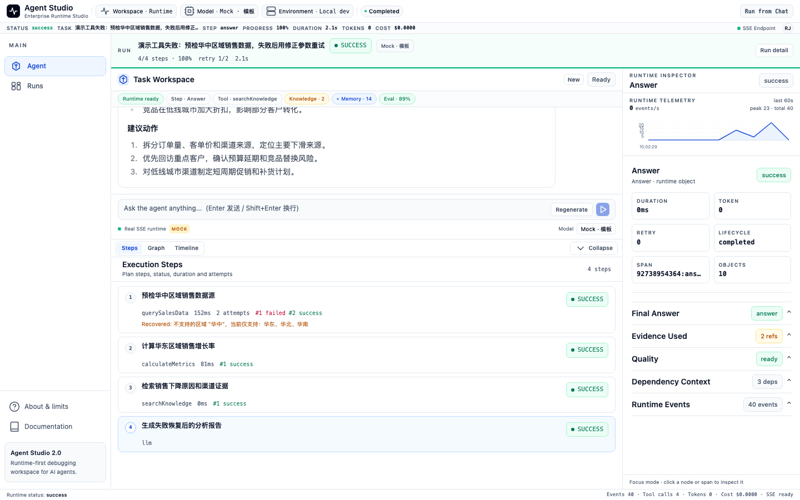

# Agent Studio

一个本地运行的 AI Agent 控制台。你可以跑一个任务，看它每一步在做什么；工具报错时，看到失败的是哪一步、参数是什么、错在哪里；改完参数后只重跑那一步。跑过的任务会存在本地，之后可以打开回看。

React + Node.js + SSE。默认走 Mock 模型，配置 Key 后可以接 OpenAI 兼容接口。

[](https://github.com/novedu/agent-studio/actions/workflows/ci.yml)




失败时任务头变红，步骤列表停在出错的那一步，参数可以直接改。

## 能做什么

- 运行任务，实时看到计划、工具调用、检索、评测、反思、记忆和最终答案。
- 工具失败时定位到具体步骤，编辑参数，只重跑失败步。
- 取消运行中的任务。已完成的任务会拒绝取消，界面刷新真实状态。
- 在 `/runs` 看历史，在 `/runs/:runId` 看单次运行的答案、步骤、证据、记忆、评分和事件。
- 任务头显示本次用的是 Mock 还是真实模型。

重试成功后，同一步会保留两次 attempt：



## 本地运行

需要 Node 20+。

```bash
npm install
cp .env.example .env   # 可选，不配 Key 就走 Mock
npm run dev:all
```

打开终端里打印的地址，默认是 http://127.0.0.1:5173。服务端在 3001；如果端口被占用，按终端提示改。

也可以分开起：

```bash
npm run server
npm --prefix apps/agent-console run dev
```

首页有两个入口：

- `Run full demo`：正常流程。
- `Tool error -> step retry`：真实失败，改参数后重试。

## 哪些是真实实现，哪些是 Mock

| 部分 | 现在是什么状态 |
| --- | --- |
| 计划、步骤执行、工具调用、SSE、取消、步骤重试、运行历史 | 真实实现 |
| 模型 | 配 Key 时接真实模型；否则走 Mock 脚本 |
| 工具返回的数据 | 示例数据 |
| RAG | 关键词检索，3 篇内置文档，没有向量库 |
| 记忆 | 进程内，不持久化 |
| 评测 | 规则评分，不是模型评审 |
| 审批 | 没有高风险工具，也没有审批 UI |
| 登录、多租户 | 没有 |

## 一次运行怎么走

1. 前端 `POST /api/agent/tasks` 创建任务。
2. 服务端把任务交给 runtime，runtime 逐步执行计划，并发出事件。
3. 服务端把事件写进任务快照和 JSONL，同时通过 SSE 推给前端。
4. 前端把事件投影成一套 Runtime Object，Chat、Steps、Graph、Timeline、Inspector 都从这套对象渲染。
5. 工具失败时任务进入 failed，失败步骤和参数留在快照里。重试时从失败步骤恢复，复用原会话继续执行。

Run / Step / Attempt 都存在任务快照里，所以 Run detail 能看到每一步试了几次、每次的参数和错误。

架构细节见 [docs/ARCHITECTURE.md](docs/ARCHITECTURE.md)。

## 目录

```text
apps/
  agent-console/     React 控制台
  runtime-server/    HTTP + SSE 服务
packages/
  agent-runtime/     Planner、Workflow、Tool、RAG、Memory、Evaluation
  shared-types/      前后端共享类型
```

运行数据默认在 `.data/`，可以用 `AGENT_DATA_DIR` 改。`tasks.json` 存任务快照，`events/<taskId>.jsonl` 存事件。

## 测试

```bash
npm test
npm run lint
npm run build
```

`npm test` 会先扫密钥，再跑会话、Mock、可靠性、健康检查、步骤重试、持久化和前端测试。当前是 41 个前端测试和 7 个后端脚本。

这个项目没有做用户测试，是个人项目。测试主要保证演示链路不崩，不代表生产可用。

## 限制

- 会话不持久化。服务重启后历史还在，但步骤级重试会报 `Retry context unavailable`，只能整任务重跑。
- 历史是本地 JSON，没有分页、搜索和清理。Runs 列表最多显示 12 条。
- Timeline 是事件投影，不是分布式 trace。
- 没有接 provider 的 usage，token 和 cost 显示 0。
- RAG 是关键词匹配，评测是规则评分，别把它们当成向量检索或模型评审。
- 没有登录、权限和多租户。

## 文档

- [Architecture](docs/ARCHITECTURE.md)
- [Demo](docs/DEMO.md)
- [Contributing](docs/CONTRIBUTING.md)
- [Changelog](docs/CHANGELOG.md)
- [Performance](docs/PERFORMANCE.md)

## License

MIT
