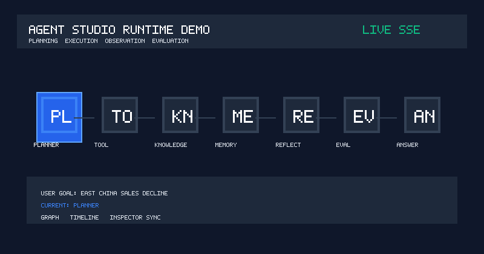
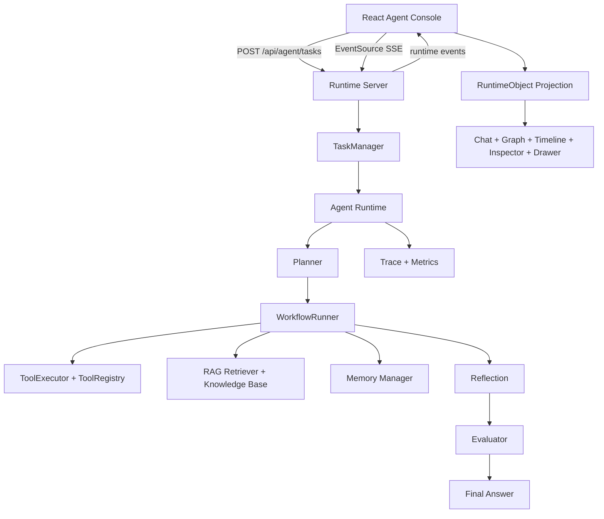
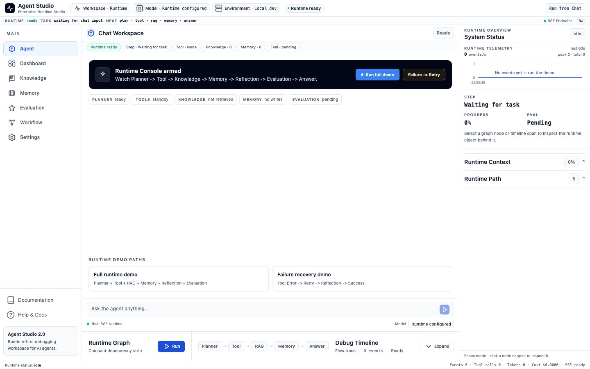
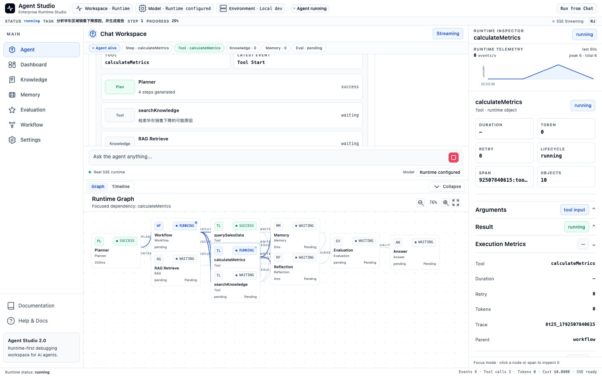
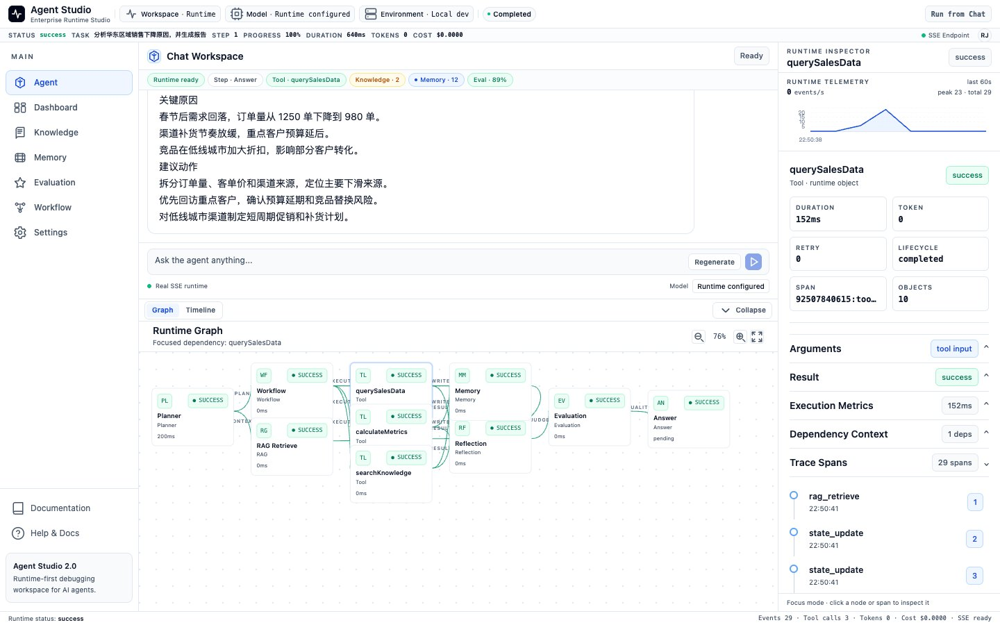
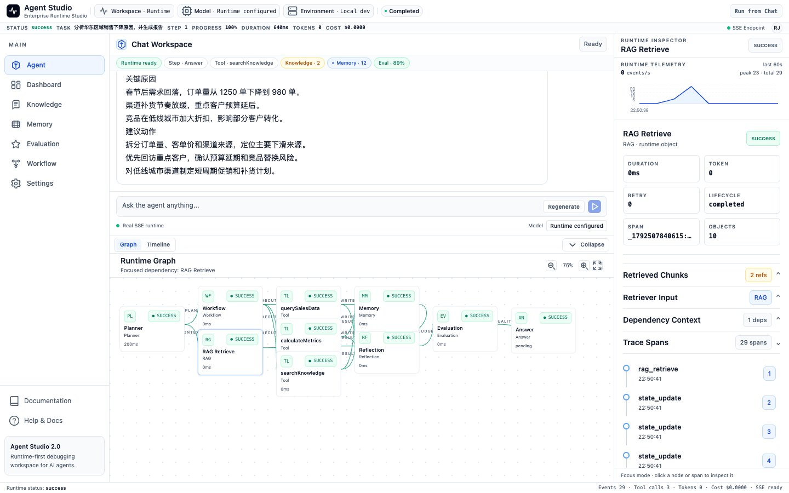
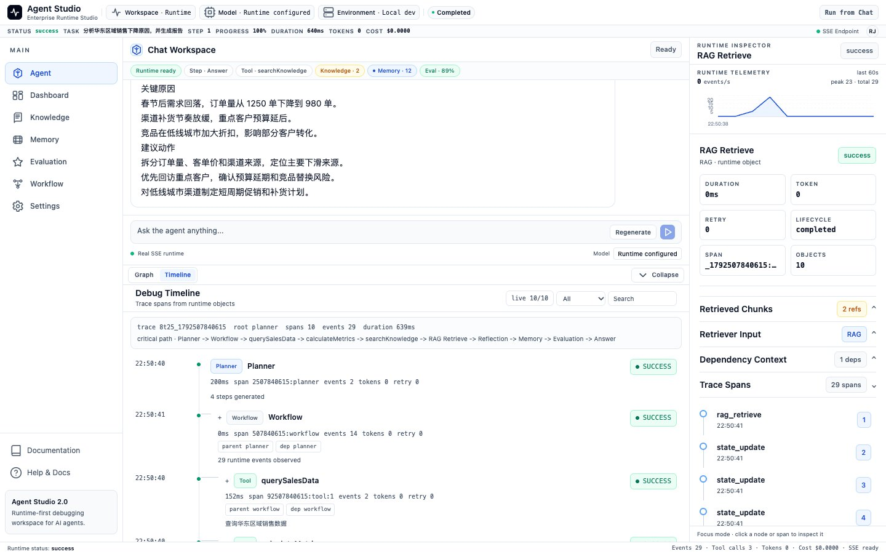
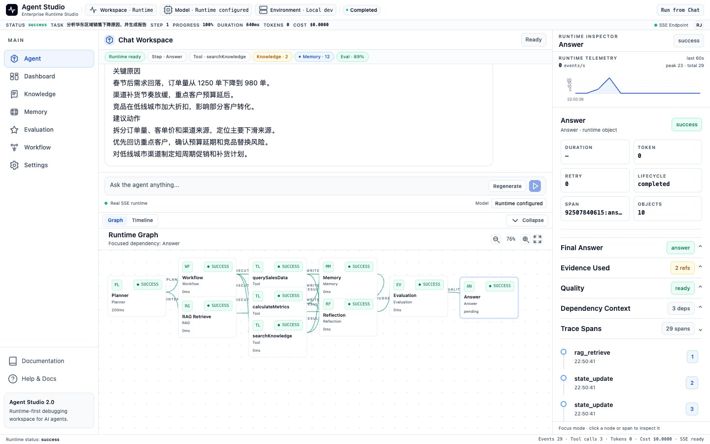
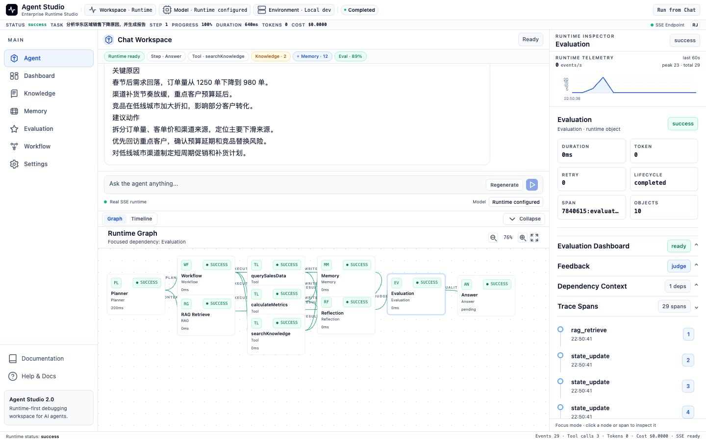

# Agent Studio

[](https://github.com/novedu/agent-studio/actions/workflows/ci.yml)


> **中文简介** — AI Agent Runtime 控制台：把 Agent 的规划、工具调用、检索、反思与评测过程，变成可观测、可解释的事件流。
>
> **技术栈** TypeScript · React · Node.js · Zustand · SSE · npm workspaces
>
> **实现说明（如实披露）** 见下方 [Implementation Notes](#implementation-notes实现说明) —— 含真实 LLM 接入方式、Mock 回退逻辑与 RAG 当前实现。

AI Agent Runtime Studio for planning, execution, observation, memory, retrieval, reflection, and evaluation.

This is a portfolio project for AI Agent Platform / AI Agent full-stack interviews. It is not a ChatGPT clone, not a dashboard template, and not a fake SaaS shell. The core goal is to make an interviewer believe the candidate understands how an Agent Runtime is built, streamed, inspected, and explained.



## Project Introduction

Agent Studio turns a running AI agent into a runtime console: four synchronized views (Chat / Graph / Timeline / Inspector) projected from a single runtime state model.

The main demo starts with:

```text
分析华东区域销售下降原因，并生成报告
```

The runtime then moves through:

```text
Planning -> Tool Call -> Knowledge Retrieval -> Memory Update -> Reflection -> Evaluation -> Final Answer
```

The `/agent` page is the product center. Chat is the primary workspace. Graph explains runtime dependency. Timeline debugs event flow. Inspector and Drawer explain the selected RuntimeObject.

## Features

- **Agent Runtime lifecycle**: Planner, WorkflowRunner, ToolExecutor, RAG, Memory, Reflection, Evaluation, and Final Answer.
- **Real Runtime Server**: task creation, task query, cancel, retry, and SSE event streaming.
- **RuntimeObject model**: one projected object model shared by Chat, Graph, Timeline, Inspector, Drawer, Evidence, Memory, and Evaluation.
- **Execution Graph**: compact dependency graph for Planner, Workflow, Tool, Knowledge, Memory, Reflection, Evaluation, and Answer.
- **Debug Timeline**: runtime spans with component, status, duration, retry, token, metadata, input, and output.
- **Professional Inspector**: object-driven panels for execution, input, output, reasoning, trace, evidence, memory, evaluation, and logs.
- **Portfolio demo path**: one-click demo task plus failure recovery demo for Tool Error -> Retry -> Reflection -> Success.

## Architecture



## Runtime Flow

```text
User Goal
  -> createAgentTask(input)
  -> Runtime Server creates task
  -> Agent Runtime emits events
  -> SSE streams AgentServerEvent
  -> Zustand updates session state
  -> RuntimeObject projection
  -> Chat / Graph / Timeline / Inspector / Drawer synchronize
```

Supported events include:

```text
task_created
plan_start
plan_update
tool_start
tool_success
tool_error
task_retry
rag_retrieve
memory_update
reflection
evaluation_start
evaluation_complete
state_update
final_answer
task_complete
```

## Demo Screenshots

All screenshots are captured from the local demo task:

```text
分析华东区域销售下降原因，并生成报告
```

The seven frames below follow one runtime session from idle to evaluation. They are intentionally shown as full-width frames so the runtime behavior remains legible on the GitHub project page.

### 1. Idle Runtime Console

Ready state before the task starts: quick demo entry, runtime path, and the initial Inspector context.



### 2. Running Agent Task

The sales decline task is active and the console follows the current `RuntimeObject`.



### 3. Tool Call

`ToolExecutor` calls sales-data and metric tools while Chat, Graph, Timeline, and Inspector update together.



### 4. Knowledge Retrieval

RAG retrieves evidence for the East China sales decline causes and exposes source chunks.



### 5. Debug Timeline

The Timeline shows runtime spans, duration, component, status, retry, token, and trace context.



### 6. Runtime Inspector

The selected Final Answer object exposes output, evidence, dependencies, and trace spans.



### 7. Evaluation

Evaluation Center shows score, criteria, feedback, and quality review for the completed sales task.



## Tech Stack

| Layer | Technology |
| --- | --- |
| Frontend | React, TypeScript, Vite, React Router |
| State | Zustand |
| UI | Tailwind CSS, Framer Motion, local design tokens |
| Server | Node.js HTTP server, TypeScript |
| Streaming | Server-Sent Events |
| Runtime | Planner, WorkflowRunner, ToolExecutor, RAG, Memory, Reflection, Evaluation |
| Shared Contracts | TypeScript shared-types package |

## Documentation

The project documentation is organized by responsibility:

- [Product](docs/PRODUCT.md): positioning, users, information architecture, and roadmap context.
- [Design](docs/DESIGN.md): visual principles and Runtime Workspace direction.
- [UX](docs/UX.md): navigation, interaction, and runtime state transitions.
- [Design System](docs/DESIGN_SYSTEM.md): shared tokens and component rules.
- [Architecture](docs/ARCHITECTURE.md): frontend, server, runtime, and streaming boundaries.
- [Demo Scripts](docs/DEMO_SCRIPT.md): 3-minute, 10-minute, and 30-minute walkthroughs.
- [Contributing](docs/CONTRIBUTING.md): development flow and verification commands.
- [Changelog](docs/CHANGELOG.md): implementation history.

## Folder Structure

```text
apps/
├── agent-console/
│   └── src/
│       ├── components/
│       ├── features/agent-console/
│       ├── hooks/
│       ├── layout/
│       ├── pages/
│       ├── router/
│       ├── services/
│       ├── store/
│       ├── theme/
│       └── types/
└── runtime-server/
    └── src/
        ├── runtime/
        ├── sse/
        └── task/

packages/
├── agent-runtime/
│   └── src/
│       ├── agent/
│       ├── evaluation/
│       ├── llm/
│       ├── memory/
│       ├── observability/
│       ├── planner/
│       ├── rag/
│       ├── tool/
│       └── workflow/
├── shared-types/
└── shared-utils/

docs/
├── PRODUCT.md
├── DESIGN.md
├── UX.md
├── DESIGN_SYSTEM.md
├── ARCHITECTURE.md
├── ROADMAP.md
├── DEMO_SCRIPT.md
├── archive/
├── screenshots/
└── media/
```

## Quick Start

Install dependencies:

```bash
npm install
```

Optional: copy the frontend environment template if you want to customize local settings.

```bash
cp apps/agent-console/.env.example apps/agent-console/.env
```

Start the Runtime Server:

```bash
npm run server
```

Start the React Console in another terminal:

```bash
npm --prefix apps/agent-console run dev
```

Or start both processes with one command:

```bash
npm run dev:all
```

Open:

```text
http://127.0.0.1:5173/agent
```

The Runtime Server health endpoint is:

```text
http://127.0.0.1:3001/health
```

Frontend environment:

```text
apps/agent-console/.env.example
VITE_AGENT_SERVER_URL=http://127.0.0.1:3001
```

## Demo

Primary demo task:

```text
分析华东区域销售下降原因，并生成报告
```

Expected demo sequence:

```text
1. Chat receives the business goal.
2. Planner creates executable steps.
3. ToolExecutor queries sales data and calculates metrics.
4. RAG retrieves relevant knowledge chunks.
5. Memory stores working / episodic / semantic context.
6. Reflection checks whether the answer is complete.
7. Evaluation scores completeness, accuracy, groundedness, and task completion.
8. Final Answer streams into Chat as Markdown.
9. Graph, Timeline, Inspector, Drawer, Evidence, Memory, and Evaluation stay synchronized.
```

Demo scripts:

- [3-minute recruiter demo](docs/DEMO_SCRIPT.md#3-minute-demo)
- [10-minute technical walkthrough](docs/DEMO_SCRIPT.md#10-minute-demo)
- [30-minute deep dive](docs/DEMO_SCRIPT.md#30-minute-demo)

## Verification

```bash
npm run lint
npm run test
npm run build
```

Note: in restricted sandbox environments, `tsx` and Vite may fail with local IPC or port-listening errors such as `listen EPERM ... tsx-501/*.pipe`. Run the same commands in a normal local terminal for final verification.

The test suite covers RuntimeObject projection, SSE event projection, Knowledge and Memory derived views, Timeline modeling, Inspector rendering, and the Runtime Server health endpoint.

## Implementation Notes（实现说明）

如实说明各能力的**当前实现方式**，避免与已完成的生产能力混淆。

### 1 · Real LLM Provider

LLM 层是可替换的抽象（`packages/agent-runtime/src/llm/provider.ts`）：

```ts
export interface LLMProvider {
  name: string
  chat(messages: ChatMessage[], tools?: ToolDefinition[]): Promise<LLMResponse>
}
```

`OpenAIProvider`（`llm/openai-provider.ts`，143 行）实现**真实模型调用**：

- 真实 `fetch` 请求 `${baseURL}/chat/completions`，携带 `Authorization: Bearer ${apiKey}`
- 默认 `baseURL = https://api.openai.com/v1`，`model = gpt-4.1-mini`
- 解析 `choices[0].message` 与 `tool_calls`（含 `function.name` / `function.arguments`）
- 对 HTTP 错误、空响应、tool call 字段缺失、参数解析失败做**错误归一化**

由于走的是 OpenAI **兼容协议**，修改 `baseURL` 即可对接 DeepSeek / Qwen 等网关。

启用方式：

```bash
OPENAI_API_KEY=sk-xxx
OPENAI_BASE_URL=https://api.openai.com/v1   # 可替换为任意兼容网关
OPENAI_MODEL=gpt-4.1-mini
```

### 2 · Mock Provider

`MockLLMProvider`（`llm/mock-llm-provider.ts`，99 行）用于**离线演示与本地开发**：

- 构造时注入一组预设响应队列，`chat()` 按 `index` 顺序返回
- 默认 `delayMs = 200`，模拟真实流式节奏
- 队列耗尽返回 `{ content: 'No more responses.', done: true }` —— **不会伪装成模型输出**
- 选择逻辑（`agent/main.ts`、`apps/runtime-server/src/runtime/agent-runtime-adapter.ts`）：

```ts
const realLLMProvider = process.env.OPENAI_API_KEY
  ? new OpenAIProvider({ apiKey, baseURL, model })
  : undefined
const llmProvider = realLLMProvider ?? mockLLMProvider
```

即：**无 API Key 时整条 Agent 链路依然可以跑通**，便于演示、CI 与本地开发。

### 3 · RAG 当前实现

**当前是关键词检索，不是向量检索。**

`Retriever.retrieve(query, topK = 3)`（`rag/retriever.ts`）的实际逻辑：

1. `tokenize()`：小写化 → 按中英文标点切分 → 中文额外做**二字滑窗（bigram）**切分
2. 打分：`score = matchedKeywords.length`（**命中关键词计数**）
3. 过滤 `score > 0` → 按 score 降序 → 取 `topK`

**本项目内没有 Embedding 模型、没有向量数据库、没有余弦相似度。**
知识库内容为 `createDefaultKnowledgeBase()` 注入的**内置示例文档**（`KnowledgeBase` 是内存中的文档数组）。

项目 Settings 页面原文：

> *"Document ingestion and vector index management are future work."*

向量检索与文档上传管线是明确的**下一步计划**，不是正在实现中的能力。

### 4 · Runtime 架构

monorepo 结构：`apps/`（agent-console、runtime-server）+ `packages/`（agent-runtime、shared-types、shared-utils）。

`agent-runtime` 的实际模块与导出：

| 模块 | 导出 |
|---|---|
| `agent/` | Agent、ConversationManager、EventEmitter |
| `planner/` | Planner、PlanValidator |
| `workflow/` | WorkflowRunner、AgentState |
| `tool/` | ToolRegistry、ToolExecutor（`ToolTimeoutError` / `ToolArgumentError` / `ToolNotFoundError`） |
| `rag/` | Retriever、KnowledgeBase、ContextBuilder |
| `memory/` | MemoryManager / MemoryUpdater / MemoryRetriever；Working / Episodic / Semantic 三层记忆 |
| `observability/` | TraceManager、Span、AgentMetrics |
| `evaluation/` | RuleBasedEvaluator |

`runtime-server` 负责任务生命周期（`task-manager` / `task-store` / `task-repository`）
与 SSE 事件流（`sse/event-stream.ts`），共 **15 类**运行时事件。

---

## What Is Real Today

Implemented:

- TypeScript Agent Runtime
- Planner and PlanValidator
- WorkflowRunner
- ToolRegistry and ToolExecutor
- RAG retrieval over a local knowledge base
- Working / Episodic / Semantic memory model
- Reflection
- Evaluation
- Observability primitives
- Runtime Server with task lifecycle
- SSE event streaming
- Task cancel and retry
- React Runtime Studio
- RuntimeObject projection for Graph / Timeline / Inspector / Drawer
- Dashboard, Knowledge, Memory, Evaluation, Workflow, and Settings pages for portfolio demonstration

Not implemented intentionally:

- persistent vector database
- document upload pipeline
- persistent memory database
- historical evaluation datasets
- editable workflow deployment
- RBAC / SSO / audit logs
- secret management
- billing or team administration

These are roadmap items, not fake UI claims.

## Interview Narrative

This project demonstrates:

- **Frontend ability**: React architecture, TypeScript, Zustand, SSE, design system, runtime workspace, graph, timeline, inspector, drawer, and interaction design.
- **Agent ability**: Planner, workflow execution, tool runtime, RAG, memory, reflection, evaluation, trace, and runtime events.
- **Backend ability**: task lifecycle, EventSource stream, Runtime Adapter, TaskManager, cancel/retry, and shared API contracts.
- **Product judgment**: runtime-first IA, honest boundaries, demo flow, and documentation that can be explained in interviews.

The project is optimized for one outcome: helping a candidate explain and demonstrate AI Agent Platform engineering ability.
